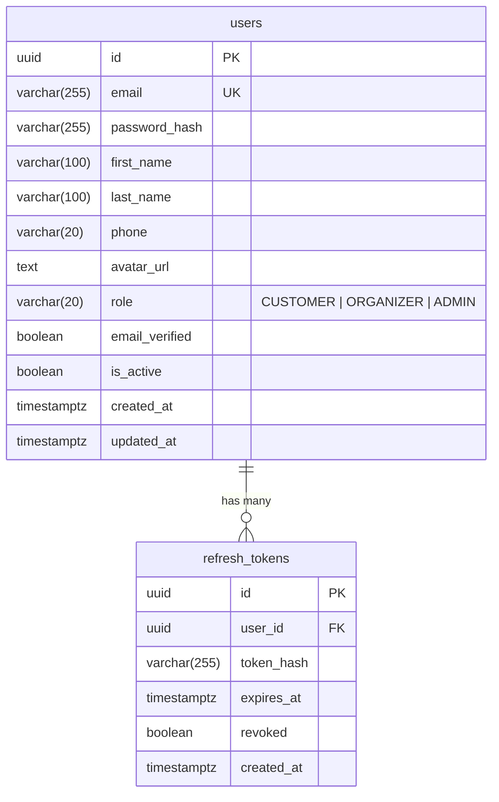

# 🗄️ Dokumentasi Database User Service

Dokumen ini adalah panduan spesifikasi dan eksekusi database untuk **`user-service`** pada database **`event_ticketing_db`** (PostgreSQL 16).

---

## 1. Ikhtisar Arsitektur Database

* **Instance Database**: `event-ticketing-postgres` (PostgreSQL 16)
* **Nama Database**: `event_ticketing_db`
* **Skema**: `public`
* **Ekstensi yang Dibutuhkan**: `pgcrypto` atau `uuid-ossp` (untuk fungsi `gen_random_uuid()`)

---

## 2. Struktur Tabel & Relasi



---

## 3. Spesifikasi Kamus Data (Data Dictionary)

### 3.1 Tabel `users`
Menyimpan data identitas, autentikasi, profil, dan hak akses pengguna.

| Kolom | Tipe Data | Nullable | Default | Keterangan |
|---|---|---|---|---|
| `id` | `UUID` | NO | `gen_random_uuid()` | Primary Key unik pengguna |
| `email` | `VARCHAR(255)` | NO | - | Email unik untuk login |
| `password_hash` | `VARCHAR(255)` | NO | - | Hash password (bcrypt) |
| `first_name` | `VARCHAR(100)` | NO | - | Nama depan pengguna |
| `last_name` | `VARCHAR(100)` | YES | NULL | Nama belakang pengguna |
| `phone` | `VARCHAR(20)` | YES | NULL | Nomor telepon / WhatsApp |
| `avatar_url` | `TEXT` | YES | NULL | URL avatar foto profil |
| `role` | `VARCHAR(20)` | NO | `'CUSTOMER'` | Role akses: `CUSTOMER`, `ORGANIZER`, `ADMIN` |
| `email_verified`| `BOOLEAN` | NO | `FALSE` | Status verifikasi email |
| `is_active` | `BOOLEAN` | NO | `TRUE` | Status aktif/non-aktif akun |
| `created_at` | `TIMESTAMPTZ` | NO | `CURRENT_TIMESTAMP` | Waktu pendaftaran |
| `updated_at` | `TIMESTAMPTZ` | NO | `CURRENT_TIMESTAMP` | Waktu pembaruan profil |

### 3.2 Tabel `refresh_tokens`
Menyimpan hash refresh token untuk otentikasi session jangka panjang.

| Kolom | Tipe Data | Nullable | Default | Keterangan |
|---|---|---|---|---|
| `id` | `UUID` | NO | `gen_random_uuid()` | Primary Key token |
| `user_id` | `UUID` | NO | - | Foreign Key mengarah ke `users(id)` |
| `token_hash` | `VARCHAR(255)` | NO | - | Hash atau identifier unik refresh token |
| `expires_at` | `TIMESTAMPTZ` | NO | - | Waktu kedaluwarsa refresh token |
| `revoked` | `BOOLEAN` | NO | `FALSE` | Status pencabutan/logout |
| `created_at` | `TIMESTAMPTZ` | NO | `CURRENT_TIMESTAMP` | Waktu pembuatan token |

---

## 4. DDL Lengkap (Copy-Paste Ready)

Anda dapat langsung mengeksekusi script SQL berikut di PostgreSQL client Anda (misal DBeaver, pgAdmin, atau CLI `psql`):

```sql
-- 1. Pastikan ekstensi UUID aktif
CREATE EXTENSION IF NOT EXISTS "pgcrypto";

-- 2. Buat tabel users
CREATE TABLE IF NOT EXISTS users (
    id UUID PRIMARY KEY DEFAULT gen_random_uuid(),
    email VARCHAR(255) UNIQUE NOT NULL,
    password_hash VARCHAR(255) NOT NULL,
    first_name VARCHAR(100) NOT NULL,
    last_name VARCHAR(100),
    phone VARCHAR(20),
    avatar_url TEXT,
    role VARCHAR(20) NOT NULL DEFAULT 'CUSTOMER' CHECK (role IN ('CUSTOMER', 'ORGANIZER', 'ADMIN')),
    email_verified BOOLEAN NOT NULL DEFAULT FALSE,
    is_active BOOLEAN NOT NULL DEFAULT TRUE,
    created_at TIMESTAMP WITH TIME ZONE DEFAULT CURRENT_TIMESTAMP,
    updated_at TIMESTAMP WITH TIME ZONE DEFAULT CURRENT_TIMESTAMP
);

-- Index tabel users untuk lookup cepat saat login
CREATE INDEX IF NOT EXISTS idx_users_email ON users(email);
CREATE INDEX IF NOT EXISTS idx_users_role ON users(role);

-- 3. Buat tabel refresh_tokens
CREATE TABLE IF NOT EXISTS refresh_tokens (
    id UUID PRIMARY KEY DEFAULT gen_random_uuid(),
    user_id UUID NOT NULL REFERENCES users(id) ON DELETE CASCADE,
    token_hash VARCHAR(255) NOT NULL,
    expires_at TIMESTAMP WITH TIME ZONE NOT NULL,
    revoked BOOLEAN NOT NULL DEFAULT FALSE,
    created_at TIMESTAMP WITH TIME ZONE DEFAULT CURRENT_TIMESTAMP
);

-- Index tabel refresh_tokens
CREATE INDEX IF NOT EXISTS idx_refresh_tokens_user_id ON refresh_tokens(user_id);
CREATE INDEX IF NOT EXISTS idx_refresh_tokens_hash ON refresh_tokens(token_hash);
```

---

## 5. Cara Eksekusi di Server / Docker

### Opsi A: Menjalankan via Terminal Docker (Rekomendasi)
Karena database berjalan di container `event-ticketing-postgres`, Anda cukup menjalankan:

```bash
docker exec -i event-ticketing-postgres psql -U admin -d event_ticketing_db << 'EOF'
CREATE EXTENSION IF NOT EXISTS "pgcrypto";

CREATE TABLE IF NOT EXISTS users (
    id UUID PRIMARY KEY DEFAULT gen_random_uuid(),
    email VARCHAR(255) UNIQUE NOT NULL,
    password_hash VARCHAR(255) NOT NULL,
    first_name VARCHAR(100) NOT NULL,
    last_name VARCHAR(100),
    phone VARCHAR(20),
    avatar_url TEXT,
    role VARCHAR(20) NOT NULL DEFAULT 'CUSTOMER' CHECK (role IN ('CUSTOMER', 'ORGANIZER', 'ADMIN')),
    email_verified BOOLEAN NOT NULL DEFAULT FALSE,
    is_active BOOLEAN NOT NULL DEFAULT TRUE,
    created_at TIMESTAMP WITH TIME ZONE DEFAULT CURRENT_TIMESTAMP,
    updated_at TIMESTAMP WITH TIME ZONE DEFAULT CURRENT_TIMESTAMP
);

CREATE INDEX IF NOT EXISTS idx_users_email ON users(email);
CREATE INDEX IF NOT EXISTS idx_users_role ON users(role);

CREATE TABLE IF NOT EXISTS refresh_tokens (
    id UUID PRIMARY KEY DEFAULT gen_random_uuid(),
    user_id UUID NOT NULL REFERENCES users(id) ON DELETE CASCADE,
    token_hash VARCHAR(255) NOT NULL,
    expires_at TIMESTAMP WITH TIME ZONE NOT NULL,
    revoked BOOLEAN NOT NULL DEFAULT FALSE,
    created_at TIMESTAMP WITH TIME ZONE DEFAULT CURRENT_TIMESTAMP
);

CREATE INDEX IF NOT EXISTS idx_refresh_tokens_user_id ON refresh_tokens(user_id);
CREATE INDEX IF NOT EXISTS idx_refresh_tokens_hash ON refresh_tokens(token_hash);
EOF
```

### Opsi B: Memverifikasi Pembuatan Tabel
Masuk ke container psql:
```bash
docker exec -it event-ticketing-postgres psql -U admin -d event_ticketing_db
```
Jalankan di dalam prompt `event_ticketing_db=#`:
```sql
\dt
\d users
\d refresh_tokens
\q
```

---

## 6. Rollback / Reset Script (Down Migration)
Jika sewaktu-waktu Anda perlu mereset atau menghapus tabel-tabel ini:

```sql
DROP TABLE IF EXISTS refresh_tokens CASCADE;
DROP TABLE IF EXISTS users CASCADE;
```
